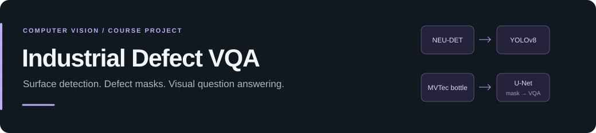
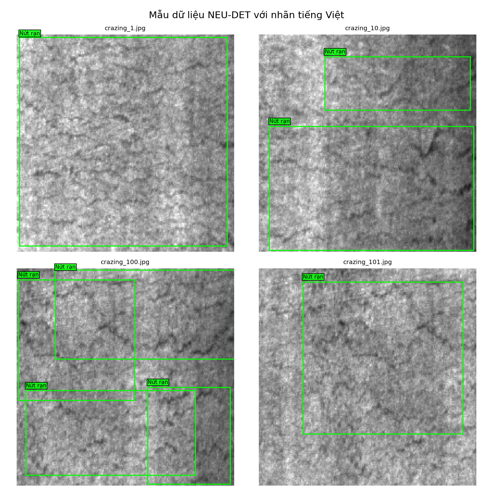

<h1></h1>

Bài tập lớn môn **Xử lý ảnh và Thị giác máy tính**. Dự án có hai luồng riêng: nhận dạng lỗi bề mặt thép, và phân vùng lỗi chai kết hợp trả lời câu hỏi về ảnh.


[Chạy ứng dụng](#chạy-ứng-dụng) · [Các module](#các-module) · [Giao diện](docs/APP_GUIDE.md) · [Dataset](docs/DATASET_SETUP.md) · [Kết quả cần xuất](docs/OUTPUTS_4_WEEKS.md)

## Các module

| Module | Dữ liệu | Mô hình và đầu ra |
| :--- | :--- | :--- |
| Nhận dạng lỗi bề mặt | **NEU-DET**, sáu loại lỗi trên thép | YOLOv8 → bounding box, nhãn tiếng Việt, độ tin cậy |
| Phân vùng lỗi | **MVTec AD bottle** | U-Net → mask lỗi và ảnh overlay |
| Hỏi đáp ảnh | **MVTec AD bottle** và mask U-Net dự đoán | TinyViT + Transformer + Fusion MLP → câu trả lời, caption có cấu trúc |

**Hai bộ dữ liệu được dùng tách biệt.** Mô hình YOLO học trên thép NEU-DET không được dùng để suy luận ảnh chai MVTec. Luồng VQA dùng mask do U-Net dự đoán, không lấy ground-truth mask làm đầu vào khi suy luận.

### Ảnh từ bước khảo sát dữ liệu



<p align="center"><sub>Mẫu gán nhãn của NEU-DET trong bước EDA; không phải ảnh dự đoán của mô hình.</sub></p>

## Chạy ứng dụng

Ứng dụng Gradio chạy local. Bạn cần tải artifact huấn luyện từ Kaggle trước khi dùng đầy đủ các module; clone mã nguồn không đồng nghĩa đã có model.

### 1. Cài môi trường

```powershell
git clone https://github.com/TrinhQuocDat542005/Industrial_Defect_VQA.git
cd Industrial_Defect_VQA
python -m venv .venv
.\.venv\Scripts\Activate.ps1
python -m pip install -r requirements.txt
```

Linux/macOS kích hoạt bằng `source .venv/bin/activate`. Dependencies gồm PyTorch, Ultralytics, Transformers và Gradio 5.x.

### 2. Lấy model từ Kaggle

Sau khi huấn luyện trong môi trường Kaggle, đóng gói artifact:

```bash
python scripts/dong_goi_artifact_kaggle.py
```

Tải `outputs/Industrial_Defect_VQA_artifacts_kaggle.zip` về máy. Trong terminal local, thay đường dẫn ví dụ bằng vị trí ZIP thực tế:

```powershell
python scripts/nhap_artifact_kaggle.py "C:\path\to\Industrial_Defect_VQA_artifacts_kaggle.zip"
python scripts/kiem_tra_output_cuoi.py
```

[Hướng dẫn VS Code và Kaggle](docs/HUONG_DAN_CHAY_TU_VSCODE_KAGGLE.md) · [Chuẩn bị dataset](docs/DATASET_SETUP.md)

### 3. Mở giao diện

```powershell
python app.py
```

Truy cập [127.0.0.1:7860](http://127.0.0.1:7860), hoặc địa chỉ terminal hiển thị.

- **Tab nhận dạng lỗi bề mặt:** tải ảnh thép, chọn confidence threshold và xem bounding box.
- **Tab phân vùng và VQA:** tải ảnh chai, nhập câu hỏi và xem overlay, câu trả lời cùng quyết định chất lượng.

Nếu thiếu artifact, giao diện báo thành phần còn thiếu. Đối chiếu đường dẫn model theo [hướng dẫn giao diện](docs/APP_GUIDE.md) rồi nhập lại bộ artifact.

## Cách đánh giá

Threshold và `min_component_area` của U-Net được tìm trên validation theo `Dice_defect_only`. Đánh giá và postprocess diễn ra ở độ phân giải mô hình **256 × 256**, sau đó mới resize về kích thước ảnh gốc.

VQA nhận visual embedding từ TinyViT, text embedding từ Transformer và mask U-Net. Caption là **caption có cấu trúc**, không phải mô hình sinh caption tự do. Với câu hỏi chất lượng, Safety Gate đồng bộ câu trả lời với quyết định từ mask sau postprocess.

Các chỉ số cần được đối chiếu với artifact và báo cáo của cùng lượt huấn luyện. [Danh sách output](docs/OUTPUTS_4_WEEKS.md) mô tả những file cần xuất để kiểm tra kết quả.

<details>
<summary>Artifact tối thiểu cho luồng phân vùng và VQA</summary>

```text
outputs/week03_segmentation/checkpoints/unet_bottle_best.pt
outputs/week03_segmentation/best_postprocess_config.json
outputs/week04_multimodal/fusion_vqa.pt
```

[APP_GUIDE](docs/APP_GUIDE.md) mô tả điều kiện chạy. Script `kiem_tra_output_cuoi.py` kiểm tra bộ output sau khi nhập ZIP.

</details>

## Tài liệu

- [Hướng dẫn giao diện](docs/APP_GUIDE.md)
- [Dataset và cách chuẩn bị](docs/DATASET_SETUP.md)
- [Chạy từ VS Code và Kaggle](docs/HUONG_DAN_CHAY_TU_VSCODE_KAGGLE.md)
- [Kế hoạch bốn tuần](docs/PROJECT_PLAN_4_WEEKS.md) · [Output bốn tuần](docs/OUTPUTS_4_WEEKS.md)
- [Phạm vi đề tài](docs/TOPIC_ALIGNMENT.md) · [Mục lục tài liệu](docs/README.md)
